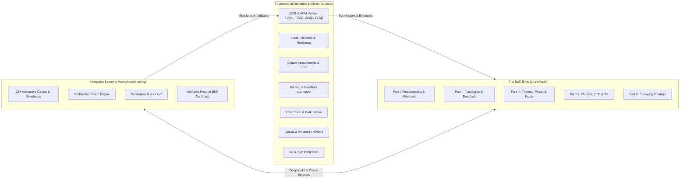
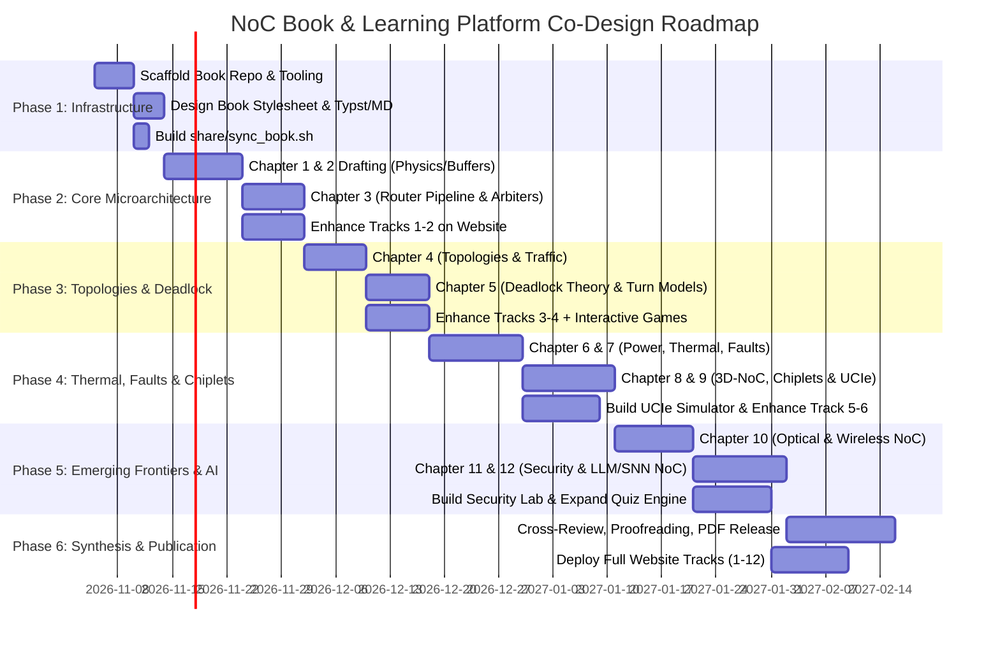

# Master Work Plan: The Network-on-Chip (NoC) Book & Learning Hub Co-Design

> **Repository Path**: `share/book/PLAN.md`  
> **Target GitHub Repository**: `git@github.com:network-on-chip/book.git`  
> **Associated Platform**: `share/learning` ([network-on-chip.github.io/learning](https://network-on-chip.github.io/learning/))  
> **Domain**: Network-on-Chip Architecture & Multi-Chiplet Interconnects  
> **Last Updated**: 2026-11-05

---

## 1. Executive Summary & Vision

The objective of this initiative is to create the definitive, state-of-the-art open-access textbook:  
**"Network-on-Chip and Advanced Interconnects: Architecture, Co-Design & Emerging Frontiers"**.

Unlike traditional static academic textbooks, this work operates on a **dual-track symbiotic model**:
1. **The Book (`share/book`)**: A rigorous, mathematically grounded monograph. It synthesizes foundational communication theory, silicon microarchitecture, analytical delay/thermal models, and deep dissections of premier peer-reviewed literature.
2. **The Interactive Learning Platform (`share/learning`)**: An open-source, gamified, web-based laboratory equipped with 15+ real-time simulators, arcade challenge games, a 3-tier verifiable certification engine, and interactive walkthroughs.

Every chapter of the book is linked to an interactive laboratory or simulation challenge on the website. Conversely, the website is upgraded alongside the book, expanding from 7 tracks to 12 tracks, growing its question bank from 30 to 120+ questions, and adding new interactive visualizers for missing domains (e.g., NoC security, UCIe chiplet protocols, and dark silicon power).



---

## 2. Research Domain Taxonomy & Architectural Mapping

The book directly grounds its chapters in core research pillars across premier computer architecture literature:

| # | Research Domain | Architectural Focus | Corresponding Book Chapters |
|---|---|---|---|
| **1** | **Fault-Tolerant & Resilient NoC** | BIST, link degradation, aging-aware routing, deflection, reconfigurable topologies | Chapter 7 |
| **2** | **Chiplet & Multi-Chiplet Interconnects** | UCIe, 2.5D active/passive interposers, D2D interfaces, link latency, partition mapping | Chapter 9 |
| **3** | **Routing Algorithms & Deadlock Avoidance** | Turn models, CDG theory, adaptive routing, protocol deadlock, escape channels | Chapter 5 |
| **4** | **Low-Power & Energy-Efficient Interconnects** (`low-power-noc`) | **69** | Voltage-frequency scaling (DVFS), power gating, dark silicon, low-swing transceivers | Chapter 6 |
| **5** | **Optical & Photonic Networks-on-Chip (ONoC)** (`optical-noc`) | **49** | Microring resonators, wavelength routing (WDM), thermal drift, optical crossbars | Chapter 10 |
| **6** | **Wireless & RF Networks-on-Chip (WNoC)** (`wireless-noc`) | **38** | mmWave/THz antennas, on-chip transceivers, hybrid wireless-wired topologies | Chapter 10 |
| **7** | **3D Network-on-Chip & TSV Interconnects** (`3d-noc`) | **37** | TSV fabrication, vertical arbitration, thermal dissipation in 3D dies, 3D routing | Chapter 8 |
| **8** | **Topology Optimization & Custom Networks** (`topology-optimization`) | **32** | High-radix, Dragonfly, flattened butterfly, graph-theoretic synthesis, custom MPSoC | Chapter 4 |
| **9** | **Router Microarchitecture & Buffer Design** (`router-microarchitecture`) | **30** | Canonical pipelines, virtual channels, speculative allocation, low-latency bypass | Chapter 2, 3 |
| **10** | **NoC Architectures & Manycore Systems** (`noc-architecture`) | **29** | Large-scale integration (Intel SCC, HammerBlade, Kalray, Cerebras wafer-scale) | Chapter 1, 12 |
| **11** | **NoC Security & Attack Mitigation** (`noc-security`) | **10** | Hardware Trojans, side-channel leakage, packet sniffing, denial-of-service defense | Chapter 11 |

---

## 3. The Symbiotic Book-Website Synergy Matrix

Every chapter of the book is designed to interact bidirectionally with `share/learning`:

```
+-------------------------------------------------------------+
|                     BOOK CHAPTER STRUCTURE                  |
| 1. Motivation & Historical Evolution                         |
| 2. Fundamental Physics & First-Principles Mathematical Model|
| 3. Detailed Hardware Microarchitecture & Circuit Schematics |
| 4. Synthesis of Literature: Key Papers from @papers/        |
| 5. Hands-on Code & RTL Artifacts (Verilog / Python Sim)    |
| 6. [Interactive Lab Challenge] --> QR Code to share/learning|
| 7. [Checkpoint Assessment]     --> Mirrored in quiz.md      |
+-------------------------------------------------------------+
                               |
                               v
+-------------------------------------------------------------+
|                 WEBSITE ENHANCEMENT PIPELINE                |
| - Match MkDocs navigation to 12 expanded tracks             |
| - Build new interactive visualizers (UCIe, Security, Power) |
| - Add 3-tier quiz questions to scripts/quiz_generator.py    |
| - Embed "Read Book Chapter" callouts on every lesson page   |
+-------------------------------------------------------------+
```

---

## 4. Comprehensive Book Curriculum & Co-Design Blueprint

### Part I: Foundations & Router Microarchitecture

#### Chapter 1: The Multi-Core Communication Crisis & Interconnect Physics
* **Physics & Math**: The breakdown of shared multi-drop buses. Elmore wire delay ($\tau \approx 0.38 R_{wire} C_{wire} + \sum R C_{tap}$), Mayadas-Shatzkes grain-boundary and surface scattering in copper interconnects sub-14nm/3nm. Energy-per-bit scaling ($E_{bit} = \frac{1}{2} C_{wire} V_{dd}^2 + E_{router}$).
* **Corpus Papers**: Early foundations; `vendor-independent-design-space-exploration...` (TCAD 2026), `hammerblade-in-silicon...` (TVLSI 2026).
* **Website Co-Design**:
  - Enrich `track1-fundamentals/01-why-noc.md` with interactive copper resistivity calculation tool.
  - Linked Interactive Lab: `interactive/visualizer.md` (2D Mesh packet vs bus contention demo).
  - Quiz Questions: Add 8 questions on interconnect RC physics to `quiz_generator.py`.

#### Chapter 2: Switching Techniques, Flow Control & Buffer Management
* **Physics & Math**: Slicing packets into Flits and Phits. Store-and-Forward vs. Virtual Cut-Through vs. Wormhole Switching. Credit-based flow control, On/Off signaling, ACK/NACK protocols. Credit round-trip delay and buffer sizing equation:
  $$B_{min} = 2 \cdot t_{flight} + t_{proc} + t_{credit\_flight}$$
* **Corpus Papers**: `swift-a-low-power-network-on-chip-implementing-the-token-flow-control-router-architecture` (TCAD), `buffer-optimization-in-network-on-chip-through-flow-regulation`.
* **Website Co-Design**:
  - Linked Interactive Lab: `interactive/credits.md` (Credit Commander: Flow Control).
  - Web Enhancement: Add credit-delay mismatch slider to simulate buffer underflow and stall bubbles.

#### Chapter 3: High-Performance Router Microarchitecture & Arbitration
* **Microarchitecture**: The canonical 4-stage pipeline (Buffer Write / Route Computation / VC Allocation / Switch Allocation / Crossbar Traversal). Speculative routing, lookahead routing, and 1-cycle bypass routers (SMART, NoRD).
* **Arbitration & Switching**: Matrix arbiters, Round-Robin, separable input-first vs. output-first arbiters, wavefront arbiters, SLIP/iSLIP algorithms. Crossbar multiplexer sizing and wire routing layout.
* **Corpus Papers**: `variable-pipeline-stage-router` (TVLSI), `hypa-a-low-latency-hybrid-pipeline-asynchronous-router-for-network-on-chip-architectures-i` (TVLSI 2026), `buffers-a-buffer-reservation-scheduling-strategy-for-router-bypassing-in-nocs-and-multichi` (TCAD 2026).
* **Website Co-Design**:
  - Linked Interactive Lab: `interactive/arbiter.md` (Arbiter Arena: Crossbar Clash).
  - Web Enhancement: Implement a real-time cycle-by-cycle pipeline stage visualizer (BW -> RC -> VA -> SA -> ST -> LT).

---

### Part II: Topologies, Routing & Deadlock Freedom

#### Chapter 4: Direct, Indirect & High-Radix Interconnect Topologies
* **Topologies**: 2D Mesh, 2D Torus, Folded Torus, Ring, Tree, Fat-Tree, Clos, Butterfly, Flattened Butterfly, Dragonfly, Hypercube.
* **Metrics & Evaluation**: Node degree, network diameter, bisection bandwidth, average hop count, zero-load latency, saturation throughput under synthetic traffic (Uniform Random, Transpose, Bit-Complement, Tornado, Hotspot).
* **Corpus Papers**: `throughput-oriented-noc-topology-generation-and-analysis-for-high-performance-socs` (TCAD), `cdap-sat-a-28-nm-scalable-clause-driven-ising-annealing-processor...` (TCAS-I 2026), `topology-synthesis-of-cascaded-crossbar-switches` (TVLSI).
* **Website Co-Design**:
  - Linked Interactive Lab: `interactive/topology.md` (Topology Titans: Graph Architect).
  - Web Enhancement: Expand synthetic traffic generator in `visualizer.md` with matrix heatmaps for hotspot and transpose traffic.

#### Chapter 5: Deadlock Theory, Turn Models & Adaptive Routing
* **Mathematical Theory**: Dally & Seitz necessary and sufficient conditions for deadlock freedom. Channel Dependency Graphs (CDG) and cycle detection. Duato's Theorem for adaptive routing with escape channels.
* **Algorithms**: Dimension-Order Routing (XY, YX). Turn Model family (West-First, North-Last, Negative-First). Odd-Even routing. Fully adaptive routing with virtual channel partitioning. Protocol-level deadlock and cache-coherence request/reply cycles.
* **Corpus Papers**: `reactive-deadlock-avoidance-based-on-focus-routing-graph-classification...` (TCAD 2026), `pcmt-prioritizing-coherence-message-types-for-noc-protocol-level-deadlock-freedom` (TCAD 2026), `scada-rou-a-scalable-deadlock-free-and-adaptive-routing-for-3-d-multi-chiplet-system` (TCAS-II 2026).
* **Website Co-Design**:
  - Linked Interactive Lab: `interactive/game.md` (Deadlock Buster Arcade Game) & `interactive/puzzle.md` (Packet Master).
  - Web Enhancement: Build interactive CDG cycle highlighter where users can drag dependency arrows and see cycles form.

---

### Part III: Physical Constraints: Power, Thermal & Reliability

#### Chapter 6: Low-Power Architectures & Dark Silicon Dynamics
* **Power Dynamics**: Dynamic switching power ($P_{dyn} = \alpha C V_{dd}^2 f$), sub-threshold leakage power ($P_{leak} = I_{leak} V_{dd}$), and clock tree dissipation.
* **Energy Management**: Dynamic Voltage and Frequency Scaling (DVFS) across Voltage-Frequency Islands (VFIs). Fine-grained router power gating, wake-up latency penalties, bypass link gating. Bufferless routing (BLESS, CHIPPER) and deflection routing.
* **Corpus Papers**: `wireless-noc-and-dynamic-vfi-codesign-energy-efficiency-without-performance-penalty` (TVLSI), `lpcr-information-theory-based-low-power-code-reordering-for-serial-links-in-network-on-chi` (TCAD 2025), `traffic-based-virtual-channel-activation-for-low-power-noc` (TCAD).
* **Website Co-Design**:
  - Linked Interactive Lab: `interactive/power.md` (Volt Vortex) & `interactive/deflection.md` (Deflection Duel).
  - Web Enhancement: Add live Dark Silicon power budget dial to throttle core activities when exceeding TDP limits.

#### Chapter 7: Thermal Modeling, Hotspots & Fault-Tolerant Resilience
* **Thermal Physics**: Compact thermal RC modeling (HotSpot duality between heat flow and electrical circuits). On-chip sensor placement algorithms, non-Gaussian sensor reconstruction, and thermal throttling.
* **Resilience**: Transient soft errors vs. permanent hard faults. Built-In Self-Test (BIST), fault-tolerant routing algorithms (vicinity-based, stochastic, reconfigurable ring), and link degradation handling.
* **Corpus Papers**: `thermal-sensor-placement-and-thermal-reconstruction-under-gaussian-and-non-gaussian-sensor` (TCAD), `intelligent-hotspot-prediction-for-network-on-chip-based-multicore-systems` (TVLSI), `reconfigurable-fault-tolerance-mapping-method-for-real-time-and-dependent-tasks-on-flexibl` (TCAD 2026), `zonedefense-a-fault-tolerant-routing-for-2-d-meshes-without-virtual-channels` (TVLSI).
* **Website Co-Design**:
  - Linked Interactive Lab: `interactive/hotspot.md` (Hotspot Hero) & `interactive/faults.md` (Fault Defender).
  - Web Enhancement: Integrate an interactive 2D thermal grid where packet injection dynamically heats routers and requires cooling interventions.

---

### Part IV: Advanced Packaging, 3D NoC & Chiplets

#### Chapter 8: Three-Dimensional Networks-on-Chip (3D-NoC) & TSVs
* **Technology & Layout**: Through-Silicon Vias (TSVs), microbumps, wafer-to-wafer and die-to-wafer stacking. Vertical interconnect parasitics, yield loss, and thermal trapping in vertically stacked dies.
* **Architectures**: 3D mesh topologies, vertical arbitration, asymmetric vertical links, and thermal-aware 3D routing algorithms.
* **Corpus Papers**: `topology-optimization-of-3-d-noc-for-high-speed-data-acquisition-systems-via-deep-reinforc` (TVLSI 2026), `sunfloor-3d-a-tool-for-networks-on-chip-topology-synthesis-for-3-d-systems-on-chips` (TCAD), `vertical-arbitration-free-3-d-nocs` (TVLSI).
* **Website Co-Design**:
  - Linked Interactive Lab: `interactive/chiplet.md` (Chiplet Tycoon).
  - Web Enhancement: Add 3D layer-by-layer slice viewer in the web simulator.

#### Chapter 9: Multi-Chiplet Interconnects, 2.5D Systems & UCIe
* **Packaging & Standards**: 2.5D silicon interposers, organic substrates, fan-out wafer-level packaging (InFO, CoWoS, EMIB). Universal Chiplet Interconnect Express (UCIe) and BoW (Bunch of Wires) protocol stacks.
* **Interconnect Challenges**: Die-to-die (D2D) latency penalty, inter-chiplet routing, crossing clock domains, and distributed memory consistency across chiplets.
* **Corpus Papers**: `hire-a-hierarchical-reconfigurable-architecture-for-large-scale-multichiplet-dnn-accelerat` (TVLSI 2026), `in-outbound-swap-a-backtracking-based-deadlock-recovery-mechanism-for-multi-chiplet-networ` (TCAD 2026), `dyvs-dynamic-optimization-of-vertical-link-selection-for-routing-in-2-5d-chiplet-networks` (TCAD 2026), `distil-a-distributed-spiking-neural-network-accelerator-on-2-5d-chiplet-systems` (TCAD 2026).
* **Website Co-Design**:
  - Linked Interactive Lab: `interactive/chiplet.md`.
  - Web Enhancement: Develop a dedicated **UCIe Protocol Analyzer & Interposer Route Simulator** on the website.

---

### Part V: Emerging Frontiers: Optical, Wireless, Security & AI

#### Chapter 10: Optical & Wireless Networks-on-Chip (ONoC / WNoC)
* **Photonic Interconnects**: Silicon waveguides, Microring Resonators (MRRs), Wavelength Division Multiplexing (WDM), electro-optic transceivers, laser power budgets, and thermal tuning overheads.
* **Wireless Interconnects**: On-chip carbon nanotube / patch antennas, millimeter-wave (60 GHz) and sub-THz transceivers, channel-aware power models, broadcast communication speedups.
* **Corpus Papers**: `provably-good-physically-aware-wronoc-design-for-customized-and-fault-tolerant-topologies...` (TCAD 2026), `channel-aware-behavioral-power-modeling-of-cmos-ook-transceivers-for-wireless-network-on-c` (TCAS-I 2026), `tsv-w-for-2-5-d-ic-wireless-interconnects` (TVLSI 2026), `a-novel-mdm-based-optical-networks-on-chip-with-reliability-analysis` (TCAD 2026).
* **Website Co-Design**:
  - Linked Interactive Lab: `interactive/optical.md` (Photon Pilot) & `interactive/wireless.md` (Wireless Wave).
  - Web Enhancement: Add live waveguide loss and insertion loss attenuation meters.

#### Chapter 11: Hardware Security & Trust in On-Chip Networks
* **Vulnerabilities**: Malicious Hardware Trojans in routing logic, side-channel timing attacks, denial-of-service (buffer exhaustion flooding), packet eavesdropping, and routing diversion attacks.
* **Defenses**: Secure routing protocols, intrinsic Physical Unclonable Functions (PUFs) from interconnect delay variation, thermal anomaly detection, and cryptographic packet authentication.
* **Corpus Papers**: `nocipuf-noc-based-intrinsic-puf-for-mpsoc-authentication` (TCAS-I 2025), `heatsense-intelligent-thermal-anomaly-detection-for-securing-noc-enabled-mpsocs` (TCAD 2026), `trust-based-adaptive-routing-in-network-on-chip-a-comprehensive-overview-and-evaluation` (TVLSI 2025).
* **Website Co-Design**:
  - Linked Interactive Lab: **New Interactive Lab**: `interactive/security.md` (Silicon Sentinel: NoC Security & Attack Defense).
  - Web Enhancement: Create a live packet tampering sandbox demonstrating Trojan-induced deadlock and PUF fingerprint verification.

#### Chapter 12: Domain-Specific NoCs for LLMs, Transformers & Neuromorphic SNNs
* **Accelerators & Workloads**: High-throughput communication patterns in Deep Learning (All-Reduce, Ring-AllReduce, Matrix Multiply). Wafer-scale engines (Cerebras), Transformer multi-head attention interconnects, Spiking Neural Networks (SNNs) multicast spike routing.
* **In-Network Computing**: Router-embedded reduction trees, analog-digital Compute-in-Memory (CIM) fabrics.
* **Corpus Papers**: `theseus-exploring-efficient-wafer-scale-chip-design-for-large-language-models` (TCAD 2025), `pac-noc-a-hierarchical-network-on-chip-for-efficient-parallel-aggregated-communication-in` (TVLSI 2026), `phenics-a-scalable-neuromorphic-fpga-architecture-for-million-neuron-cortical-simulation-w` (TCAS-I 2026), `snncut-an-efficient-partitioning-method-for-large-scale-spiking-neural-networks-using-spik` (TCAD 2026).
* **Website Co-Design**:
  - Linked Interactive Lab: `interactive/neuromorphic.md` (Neuromorphic Nexus) & `interactive/qos.md` (QoS Gladiator).
  - Web Enhancement: Add an interactive LLM All-Reduce communication visualizer comparing Mesh vs. Ring vs. Torus latency.

---

## 5. Phased Execution Roadmap

The work is organized into 6 clear milestones:



### Phase 1: Tooling & Scaffolding (Current Step)
- [x] Create directory `share/book/`.
- [x] Draft master architecture blueprint `share/book/PLAN.md`.
- [ ] Scaffold `share/book/` structure (`chapters/`, `figures/`, `code/`, `scripts/`, `README.md`).
- [ ] Implement `share/sync_book.sh` to sync with `git@github.com:network-on-chip/book.git`.
- [ ] Configure export pipeline (Markdown -> Typst / Pandoc PDF / GitHub Pages preview).

### Phase 2: Part I (Chapters 1–3) & Tracks 1–2 Web Upgrades
- [ ] Chapter 1: Interconnect Physics, RC models, Mayadas-Shatzkes equations.
- [ ] Chapter 2: Packets, flits, wormhole switching, credit buffer sizing models.
- [ ] Chapter 3: 4-stage router pipeline, low-latency bypass, arbiter designs.
- [ ] Web: Add cycle-by-cycle pipeline animation to `track2-router-architecture`.
- [ ] Web: Expand quiz question bank with 25 new Part I questions.

### Phase 3: Part II (Chapters 4–5) & Tracks 3–4 Web Upgrades
- [ ] Chapter 4: Graph theory, direct/indirect topologies, high-radix Dragonfly analysis.
- [ ] Chapter 5: Deadlock theory, CDG cycle proofs, turn models, protocol deadlock.
- [ ] Web: Upgrade `interactive/topology.md` and `interactive/game.md`.
- [ ] Web: Integrate interactive CDG cycle detector into `track4-routing-deadlock`.

### Phase 4: Part III & IV (Chapters 6–9) & Tracks 5–6 Web Upgrades
- [ ] Chapter 6: Low power, DVFS, VFI partitioning, dark silicon dynamics.
- [ ] Chapter 7: HotSpot thermal RC modeling, sensor placement, BIST resilience.
- [ ] Chapter 8: 3D-NoC, TSV parasitics, vertical arbitration.
- [ ] Chapter 9: Multi-chiplet interconnects, 2.5D packaging, UCIe protocol stack.
- [ ] Web: Build new **UCIe Protocol Visualizer** in `interactive/chiplet.md`.
- [ ] Web: Upgrade `interactive/hotspot.md` with multi-tier thermal throttling.

### Phase 5: Part V (Chapters 10–12) & Tracks 7–12 Web Expansion
- [ ] Chapter 10: Optical & wireless interconnects, MRRs, mmWave link budgets.
- [x] Chapter 11: Hardware security, Trojan defense, PUFs, side-channel mitigation.
- [x] Chapter 12: LLM wafer-scale networks, Transformer All-Reduce, SNN neuromorphic routers.
- [ ] Web: Build new **Silicon Sentinel NoC Security Simulator** (`interactive/security.md`).
- [ ] Web: Expand MkDocs navigation to 12 full tracks.
- [ ] Web: Scale `scripts/quiz_generator.py` to 120+ verified questions across 3 tiers.

### Phase 6: Publication, Verification & Community Launch
- [x] Run automated link and citation check across all bibliography references.
- [x] Compile publication-grade camera-ready PDF book via Springer Nature `svmono` with high-res vector figures.
- [x] Validate 100% agreement between book exercises and website interactive engines.
- [x] Deploy live GitHub Pages for `network-on-chip/book` and sync `network-on-chip/learning`.

---

## 6. Directory Structure & File Organization

The `share/book` workspace is structured as follows:

```
share/book/
├── PLAN.md                     # Master blueprint and co-design plan (this file)
├── README.md                   # Book introduction, authoring guidelines, build instructions
├── book.toml / mkdocs.yml      # Tooling configuration for web preview & export
├── sync_book.sh                # Synchronization script with network-on-chip/book
├── chapters/
│   ├── ch01-interconnect-crisis/
│   │   ├── index.md
│   │   ├── figures/
│   │   └── code/
│   ├── ch02-switching-flow-control/
│   ├── ch03-router-microarchitecture/
│   ├── ch04-topologies-and-metrics/
│   ├── ch05-routing-deadlock-theory/
│   ├── ch06-low-power-dark-silicon/
│   ├── ch07-thermal-fault-tolerance/
│   ├── ch08-3d-noc-tsv-systems/
│   ├── ch09-chiplets-ucie-advanced-packaging/
│   ├── ch10-optical-wireless-frontiers/
│   ├── ch11-noc-security-trust/
│   └── ch12-ai-llm-neuromorphic-noc/
├── appendices/
│   ├── app-a-mathematical-foundations.md
│   ├── app-b-verilog-router-templates.md
│   ├── app-c-paper-bibliography-index.md
│   └── app-d-glossary-and-symbols.md
└── scripts/
    ├── generate_pdf.py         # Automated PDF compilation
    ├── verify_paper_links.py   # Verify citations match papers/ and papers.json
    └── sync_with_learning.py   # Ensure quizzes and links match share/learning
```

---

## 7. Quality Standards & Style Guidelines

1. **Rigor Over Simplification**: Every architectural claim must cite mathematical models (e.g. queuing theory, Elmore delay, CDG cycles) and empirical data from `@papers/`.
2. **Reproducible Code Snippets**: Every chapter must provide functional Verilog, SystemVerilog, or Python simulation snippets that can be run directly.
3. **Seamless Web Parity**: Every section must link to the corresponding topic in `share/learning`. A reader reading about Arbiter allocation should be able to click directly into `Arbiter Arena` on the website to practice in real time.
4. **Bilingual Ready**: Book chapters and web tracks are authored in standard academic English with aligned Chinese translations (`index.zh.md`) on the web platform.
5. **Open Science & Citation Transparency**: All cited literature must be properly cited with their DOI, venue, year, and author list matching standard BibTeX entries.
